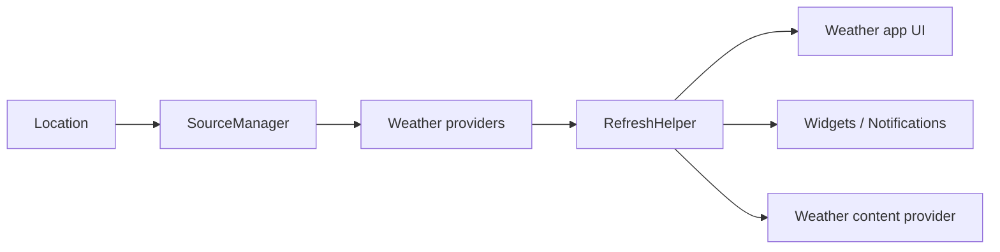

# breezy-weather/breezy-weather

> Free Android weather app in Material 3, fed by more than 50 sources.

## The problem
Weather apps force their sources on you, show ads, or collect personal data.

## What it actually does
Shows forecasts up to 16 days, hourly precipitation, alerts, air quality, pollen, with charts, widgets, and animated backgrounds. Interchangeable sources, including Open-Meteo. The source manager fetches the data and a refresh job runs in the background; notifications and optional sharing to Gadgetbridge. No trackers and no automatic crash reporting.

## How it is wired

## Trying it
No command: install via GitHub, Obtainium, or F-Droid (buttons in the README).

## Cost and gotchas
Free. Paid or intrusive sources are excluded; the F-Droid variant contains only free sources.

## What it is not
Not on the Play Store, and no refresh more frequent than 30 minutes (rejected by the project).

## Alternatives
No alternative named in the README.

## For you
Unrelated to data/AI: ignore, except as a weather app for your Android.
