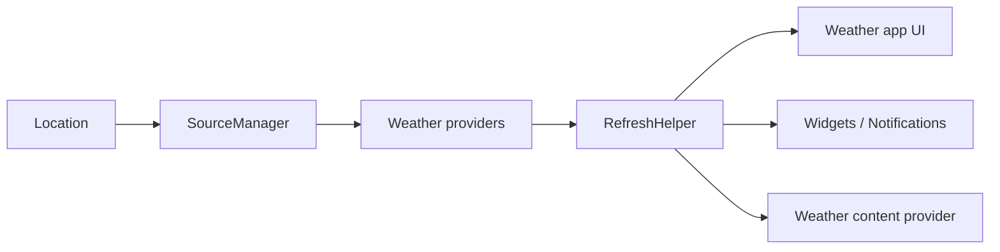

# breezy-weather/breezy-weather

> Application météo Android libre en Material 3, alimentée par plus de 50 sources.

## Le problème
Les applis météo imposent leurs sources, leur publicité ou collectent des données personnelles.

## Ce que ça fait vraiment
Affiche prévisions jusqu'à 16 jours, précipitations à l'heure, alertes, qualité d'air, pollens, avec graphiques, widgets et fonds animés. Sources interchangeables, dont Open-Meteo. Le gestionnaire de sources récupère les données et un job d'actualisation tourne en arrière-plan ; notifications et partage optionnel vers Gadgetbridge. Pas de traqueur ni de rapport de plantage automatique.

## Comment c'est branché

## Essayer
Aucune commande : installation par GitHub, Obtainium ou F-Droid (boutons du README).

## Coût et pièges
Gratuit. Les sources payantes ou intrusives sont exclues ; la variante F-Droid ne contient que des sources libres.

## Ce que ce n'est pas
Pas sur le Play Store, et pas de rafraîchissement plus fréquent que 30 minutes (refusé par le projet).

## Alternatives
Aucune alternative nommée dans le README.

## Pour toi
Sans lien avec data/IA : à ignorer, sauf comme appli météo sur ton Android.

