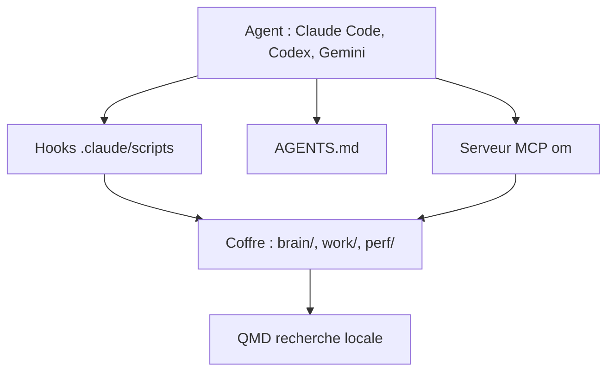

# breferrari/obsidian-mind

> Obsidian vault that gives coding agents persistent memory, for those who work with them every day.

## The problem
A coding agent forgets everything from one session to the next: goals, decisions and team context have to be re-explained.

## What it actually does
An Obsidian vault driven by hooks (session start, each message, after writing a `.md`, before compaction, stop) and `/om-*` commands. At startup, it injects goals, active projects and recent changes; it sorts content and validates links. An `om` MCP server lets you query the vault from other repositories. QMD, optional, adds local semantic search with three models.

## How it is wired
Simplified diagram based on the note, no diagram provided.


## Trying it
```bash
npm install -g shardmind
mkdir my-vault && cd my-vault
shardmind install github:breferrari/obsidian-mind
claude mcp add --scope user om node "/absolute/path/to/your-vault/.claude/scripts/om-mcp.mjs"
```

## Cost and gotchas
Free. Obsidian 1.12+ and Node 22+. QMD downloads about 2.2 GB of local models. The Claude Code mod runs unsandboxed code: the README advises validating it before trusting the folder.

## What it is not
Not a memory managed by a service: everything lives in local files. Codex and Gemini hooks require manual approvals, and full support remains that of Claude Code.

## Alternatives
No alternative named in the README.

## For you
Worth watching: the idea of a versioned vault as agent memory is solid, but the tool is heavy and centered on career tracking.
