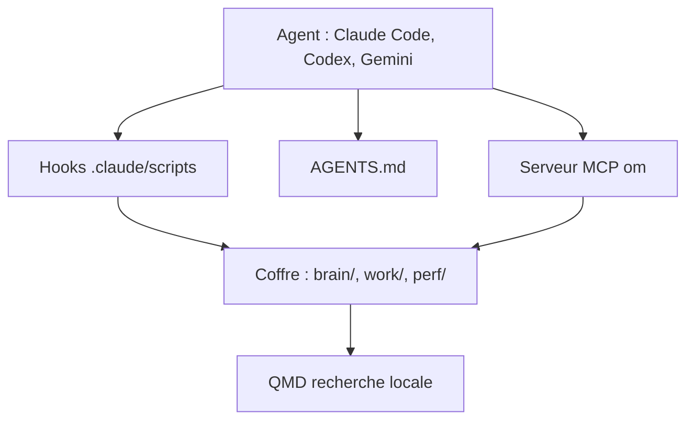

# breferrari/obsidian-mind

> Coffre Obsidian qui donne une mémoire persistante aux agents de code, pour qui travaille chaque jour avec eux.

## Le problème
Un agent de code oublie tout d'une session à l'autre : objectifs, décisions, contexte d'équipe sont à ré-expliquer.

## Ce que ça fait vraiment
Un coffre Obsidian piloté par des hooks (début de session, chaque message, après écriture de `.md`, avant compaction, arrêt) et des commandes `/om-*`. Au démarrage, il injecte objectifs, projets actifs et changements récents ; il classe le contenu et valide les liens. Un serveur MCP `om` permet d'interroger le coffre depuis d'autres dépôts. QMD, optionnel, ajoute une recherche sémantique locale avec trois modèles.

## Comment c'est branché
Schéma simplifié d'après la fiche, sans diagramme fourni.


## Essayer
```bash
npm install -g shardmind
mkdir my-vault && cd my-vault
shardmind install github:breferrari/obsidian-mind
claude mcp add --scope user om node "/absolute/path/to/your-vault/.claude/scripts/om-mcp.mjs"
```

## Coût et pièges
Gratuit. Obsidian 1.12+ et Node 22+. QMD télécharge environ 2,2 Go de modèles locaux. Le mod Claude Code exécute du code non isolé : le README conseille de le valider avant de faire confiance au dossier.

## Ce que ce n'est pas
Pas une mémoire gérée par un service : tout vit en fichiers locaux. Les hooks Codex et Gemini demandent des approbations manuelles, et le support complet reste celui de Claude Code.

## Alternatives
Aucune alternative nommée dans le README.

## Pour toi
À surveiller : l'idée d'un coffre versionné comme mémoire d'agent est solide, mais l'outil est lourd et centré sur le suivi de carrière.

