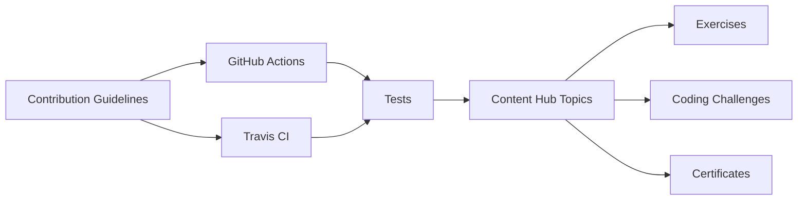

# bregman-arie/devops-exercises

> A collection of 2,624 DevOps/SRE interview questions and exercises with answers, for reviewing interview preparation.

## The problem
Preparing a DevOps or SRE interview without a structured framework requires gathering questions from various sources.

## What it actually does
A collection of Q&A organized by topic: network (TCP/IP, OSI, MAC/IP addresses), Linux, Kubernetes, AWS / Azure / GCP, Terraform, Ansible, CI/CD, Prometheus, Grafana, databases, system design, soft skills…
The repository includes code challenges (Python, shell), certification resources (AWS, Azure, Kubernetes), utility scripts, and tests run by GitHub Actions and Travis CI.
All of this information can be found in the README and the `topics` directory.

## How it is wired

## Trying it
No documented commands: the README file is being read.

## Cost and gotchas
Free. License is present but not identified by GitHub.

## What it is not
The author states that most of the questions are not genuine interview questions, and that one shouldn't try to learn everything. The answers are brief and of varying quality.

## Alternatives
- KubePrep — a Kubernetes revision application mentioned in the README.
- Linux Master — a Linux revision application mentioned in the README.
- System Design Hero — a system design revision application mentioned in the README.

## For you
This information is for reference only, and should not be used as a substitute for reviewing Kubernetes and CI/CD before an MLOps interview.
