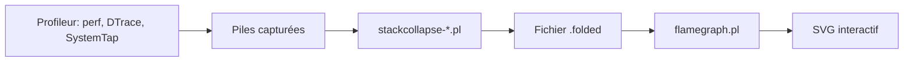

# brendangregg/FlameGraph

> Perl scripts that turn call-stack samples into interactive SVG flame graphs, for performance analysis.

## The problem
A profiler outputs thousands of call stacks that are hard to read: you can't see which function consumes the CPU.

## What it actually does
Three steps: capture stacks (Linux perf_events, DTrace, SystemTap, FreeBSD pmcstat, XCode Instruments…), fold them into lines with a `stackcollapse-*.pl` script (perf, gdb, jstack, Go pprof, VTune…), then `flamegraph.pl` produces an SVG where you click to zoom and search by regular expression. Options for color (java, js, mem, io), scale, inversion (icicle graph), flame chart, and a consistent palette across two captures.

## How it is wired


## Trying it
```bash
perf record -F 99 -a -g -- sleep 60
perf script > out.perf
./stackcollapse-perf.pl out.perf > out.folded
./flamegraph.pl out.folded > flame.svg
```

## Cost and gotchas
Free. You need a profiler beforehand, often with root rights. No license declared in the catalog, last push in October 2024, a single author: the README says nothing about longevity.

## What it is not
Not a profiler: it captures nothing itself. The SVG shows where time goes, not why.

## Alternatives
The README points to CPU and memory profiling methods (perf_events, DTrace, XCode Instruments, Xperf) on the author's website; no other repository named.

## For you
Adopt: a reference for understanding where the CPU goes in an inference service or a training run, easy to replay on the CLI; check the absence of a license before integrating it into a product.
