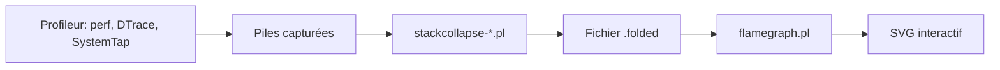

# brendangregg/FlameGraph

> Scripts Perl qui transforment des échantillons de piles d'appels en graphiques en flammes SVG interactifs, pour l'analyse de performance.

## Le problème
Un profileur sort des milliers de piles d'appels difficiles à lire : on ne voit pas quelle fonction consomme le CPU.

## Ce que ça fait vraiment
Trois étapes : capturer des piles (Linux perf_events, DTrace, SystemTap, FreeBSD pmcstat, XCode Instruments…), les replier en lignes avec un script `stackcollapse-*.pl` (perf, gdb, jstack, pprof Go, VTune…), puis `flamegraph.pl` produit un SVG où l'on clique pour zoomer et cherche par expression régulière. Options de couleur (java, js, mem, io), échelle, inversion (icicle graph), flame chart, palette cohérente entre deux captures.

## Comment c'est branché


## Essayer
```bash
perf record -F 99 -a -g -- sleep 60
perf script > out.perf
./stackcollapse-perf.pl out.perf > out.folded
./flamegraph.pl out.folded > flame.svg
```

## Coût et pièges
Gratuit. Il faut un profileur au préalable, souvent avec des droits root. Aucune licence déclarée au catalogue, dernier push en octobre 2024, un seul auteur : le README ne dit rien de la pérennité.

## Ce que ce n'est pas
Pas un profileur : il ne capture rien lui-même. Le SVG montre où le temps passe, pas pourquoi.

## Alternatives
Le README renvoie vers des méthodes de profilage CPU et mémoire (perf_events, DTrace, XCode Instruments, Xperf) sur le site de l'auteur ; aucun autre dépôt nommé.

## Pour toi
À adopter : référence pour comprendre où part le CPU d'un service d'inférence ou d'un entraînement, simple à rejouer en CLI ; vérifie l'absence de licence avant de l'intégrer à un produit.

