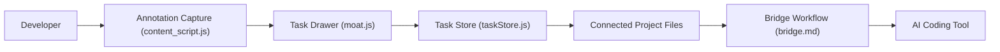

# breschio/drawbridge

> Chrome extension to annotate a running app and generate tasks readable by coding agents.

## The problem
Describing a UI bug to a coding agent in text is imprecise; the selector, screenshot and context are missing.

## What it actually does
You click an element or draw a rectangle and leave a comment; the extension captures the selector, context, bounding box and screenshot, and writes files into the connected project (`.moat/moat-tasks.md`, detailed JSON, screenshots). It deploys a `/bridge` command for Claude Code, Codex and Windsurf, with three modes: step by step, batch, "yolo".

## How it is wired


## Trying it
```bash
npm ci
npm test -- chrome-extension/background.test.js --runInBand
npm run build
```
Installation: `chrome://extensions`, developer mode, "Load unpacked" on `drawbridge/chrome-extension/`.

## Cost and gotchas
Free. The extension loads unpacked and requests access to the project folder; it modifies `.gitignore`. The "yolo bridge" mode processes everything without validation.

## What it is not
Not an automated visual testing tool nor a service. A license is present but not identified by GitHub.

## Alternatives
No alternative named in the README.

## For you
Worth watching: useful if you iterate on a web interface with a coding agent; off topic for pure data/MLOps, and the unclear license needs clarifying.
