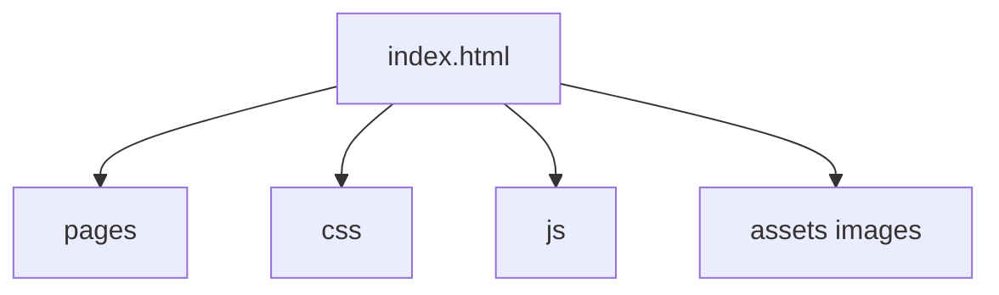

# brgkdm/DayZen-good-first-issue

> Static website for tracking daily routines, designed as a practice repository for first contributions.

## The problem
Beginners look for a simple project where they can push their first commits.

## What it actually does
HTML, CSS and JavaScript pages without a framework: home, blog, help, profile, sign-up, new project. A theme toggle is planned. The README lists improvements to make: mobile adaptation, authentication, screen-time tracking.

## How it is wired


## Trying it
```bash
git clone <repo-link>
cd DayZen
# ouvrir DayZen/index.html dans le navigateur
```

## Cost and gotchas
Free. No dependencies. Authentication and tracking are not implemented; they are ideas.

## What it is not
Not a finished productivity application: a static showcase for practice. The README also advertises another repository by the author, unrelated.

## Alternatives
No alternative named in the README.

## For you
Ignore: a beginner's front-end exercise, of no value for a data, AI or MLOps profile.
