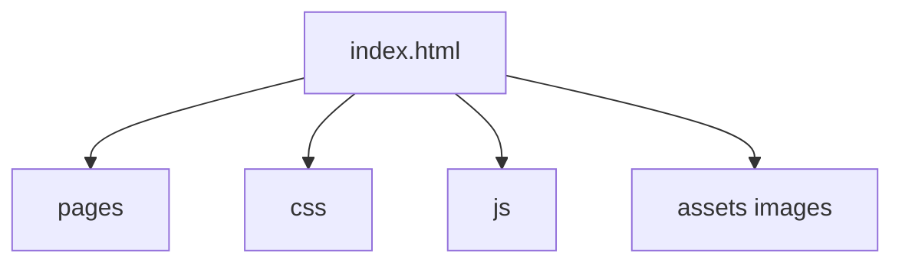

# brgkdm/DayZen-good-first-issue

> Site web statique de suivi de routines quotidiennes, pensé comme dépôt d'entraînement aux premières contributions.

## Le problème
Les débutants cherchent un projet simple où pousser leurs premiers commits.

## Ce que ça fait vraiment
Pages HTML, CSS et JavaScript sans framework : accueil, blog, aide, profil, inscription, nouveau projet. Un bascule de thème est prévu. Le README liste des améliorations à faire : adaptation mobile, authentification, suivi du temps d'écran.

## Comment c'est branché


## Essayer
```bash
git clone <repo-link>
cd DayZen
# ouvrir DayZen/index.html dans le navigateur
```

## Coût et pièges
Gratuit. Aucune dépendance. L'authentification et le suivi ne sont pas implémentés, ce sont des pistes.

## Ce que ce n'est pas
Pas une application de productivité aboutie : une vitrine statique d'exercice. Le README annonce aussi un autre dépôt de l'auteur, sans rapport.

## Alternatives
Aucune alternative nommée dans le README.

## Pour toi
À ignorer : exercice de débutant en front, sans valeur pour un profil data, IA ou MLOps.

