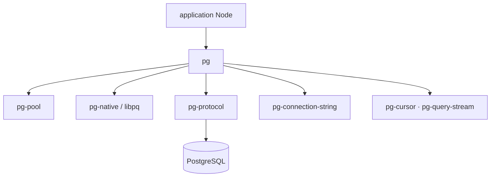

# brianc/node-postgres

> Non-blocking PostgreSQL client for Node.js, pure JavaScript with optional libpq bindings.

## The problem
Talking to PostgreSQL from Node means handling the connection pool, type conversion and the binary
protocol yourself.

## What it actually does
Monorepo grouping the `pg` module and its satellites: `pg-pool` (connection pool), `pg-native`
(libpq bindings), `pg-cursor`, `pg-query-stream`, `pg-connection-string` and `pg-protocol`. The pure
JavaScript client and the native bindings share exactly the same API. It covers parameterized queries,
named statements with execution plan caching, `LISTEN`/`NOTIFY` asynchronous notifications, bulk
import and export through `COPY TO`/`COPY FROM`, and extensible JS ↔ PostgreSQL type coercion. It also
runs on bun, deno and cloudflare.

## How it is wired


## Trying it
```bash
npm install pg
```
```bash
yarn
yarn lerna bootstrap
yarn test
```

## Cost and gotchas
Free. A PostgreSQL instance is required; for local development you need SSL enabled and an empty
test database, `libpq-dev` installed (the native bindings are compiled during the tests), and the
`PG*` variables (`PGUSER`, `PGPASSWORD`…) configured. `PGTESTNOSSL=1` lets you skip the SSL tests.

## What it is not
It is not an ORM: the README claims a library deliberately light on abstractions, and points to the
wiki for the complementary modules that "round out the picture". The usage documentation is not in
this repository; it has its own source repository.

## Alternatives
No named alternative; the full list of extras is on the project wiki.

## For you
The default client whenever a Node service in your chain touches PostgreSQL; `COPY FROM` and
`pg-query-stream` are the two points of interest for data use.
