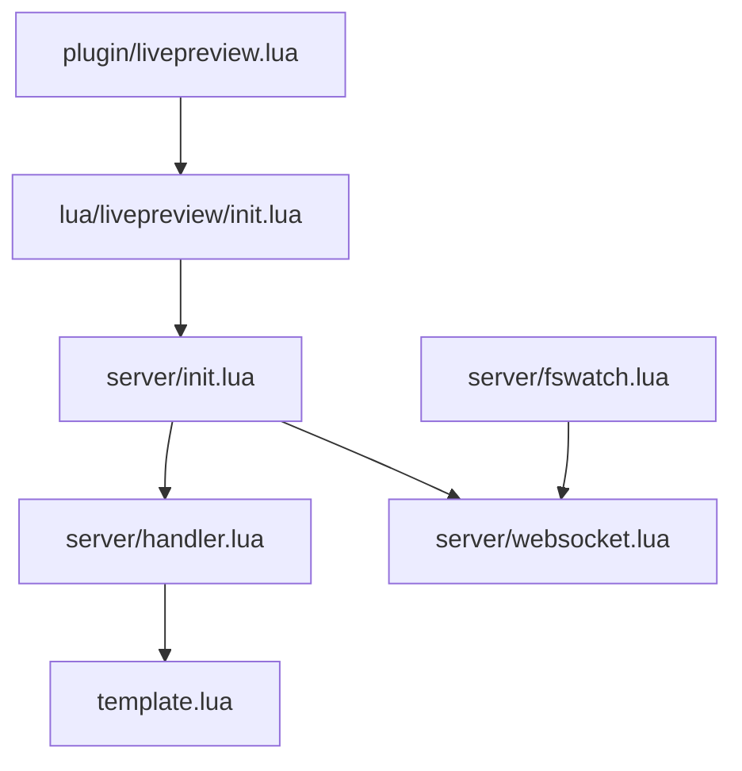

# brianhuster/live-preview.nvim

> Neovim plugin that previews Markdown, HTML, AsciiDoc and SVG in the browser, without Node or Python.

## The problem
Previewing a document being edited often requires installing a Node or Python server.

## What it actually does
An HTTP and WebSocket server written in pure Lua. `fswatch.lua` signals changes, pushed to the browser; `template.lua` builds the pages. Markdown, AsciiDoc and SVG update as you type, HTML on save. KaTeX, Mermaid, code block highlighting, synchronized scrolling.

## How it is wired


## Trying it
```bash
git clone --depth 1 https://github.com/brianhuster/live-preview.nvim ~/.local/share/nvim/site/pack/brianhuster/start/live-preview.nvim
nvim -c 'helptags ~/.local/share/nvim/site/pack/brianhuster/start/live-preview.nvim/doc' -c 'q'
```

## Cost and gotchas
Neovim 0.10.1+, a browser, PowerShell on Windows. GPL-3.0 license.

## What it is not
Not a standalone Markdown editor. The HTML preview only updates on save, unless you add an auto-save autocommand.

## Alternatives
The README points to a wiki for alternatives, without naming them.

## For you
Ignore: handy if you write notes or notebooks in Markdown under Neovim, but it remains an editor convenience.
