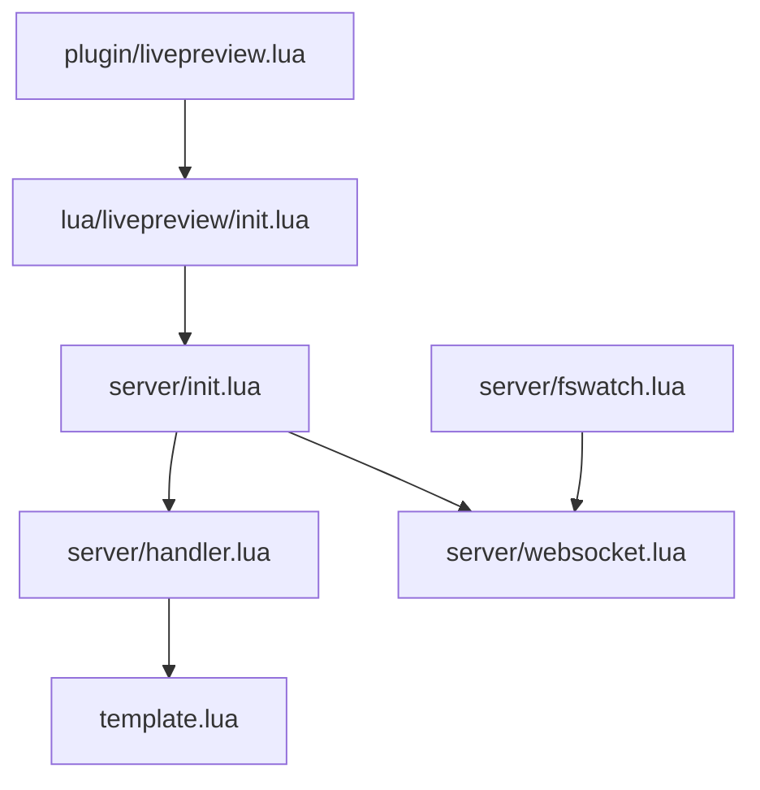

# brianhuster/live-preview.nvim

> Plugin Neovim qui prévisualise Markdown, HTML, AsciiDoc et SVG dans le navigateur, sans Node ni Python.

## Le problème
Prévisualiser un document en cours d'édition demande souvent un serveur Node ou Python à installer.

## Ce que ça fait vraiment
Un serveur HTTP et WebSocket écrit en Lua pur. `fswatch.lua` signale les changements, poussés au navigateur ; `template.lua` construit les pages. Markdown, AsciiDoc et SVG se mettent à jour à la frappe, HTML à l'enregistrement. KaTeX, Mermaid, coloration des blocs de code, défilement synchronisé.

## Comment c'est branché


## Essayer
```bash
git clone --depth 1 https://github.com/brianhuster/live-preview.nvim ~/.local/share/nvim/site/pack/brianhuster/start/live-preview.nvim
nvim -c 'helptags ~/.local/share/nvim/site/pack/brianhuster/start/live-preview.nvim/doc' -c 'q'
```

## Coût et pièges
Neovim 0.10.1+, un navigateur, PowerShell sous Windows. Licence GPL-3.0.

## Ce que ce n'est pas
Pas un éditeur Markdown autonome. L'aperçu HTML ne se met à jour qu'à la sauvegarde, sauf autocommande d'enregistrement automatique.

## Alternatives
Le README renvoie à un wiki pour les alternatives, sans les nommer.

## Pour toi
Ignorer : si tu rédiges des notes ou des notebooks en Markdown sous Neovim c'est pratique, mais cela reste un confort d'éditeur.

