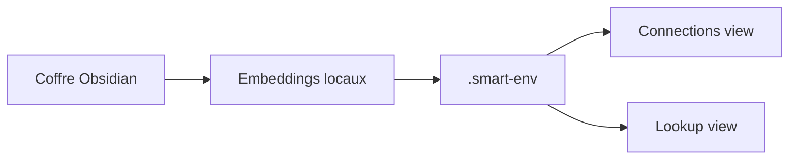

# brianpetro/obsidian-smart-connections

> Obsidian plugin that finds semantically close notes using local embeddings.

## The problem
In a vault of thousands of notes, related ideas can no longer be found, for lack of manual links.

## What it actually does
A local embeddings model indexes the vault. A Connections view lists notes close to the current note; a Lookup view does semantic search. You can pin or hide results, copy links, or send content to Smart Context for an AI chat. Advanced features (inline connections, scoring, Bases) are in Pro plugins.

## How it is wired
The repository's diagram has no readable component; general description only.

## Trying it
The README gives no command: install from Obsidian's community plugins, enable, then open the "Open: Connection view" command.

## Cost and gotchas
The core is free and local, with no API key. Pro is reserved for paying supporters. A license is present but not identified by GitHub; the README speaks of "source available".

## What it is not
Not a keyword search: a note containing the exact text may not appear. Pro features are not in the free version.

## Alternatives
The README names no alternative.

## For you
Worth watching: useful if you take technical notes in Obsidian, but the license needs clarifying and there is a single developer.
