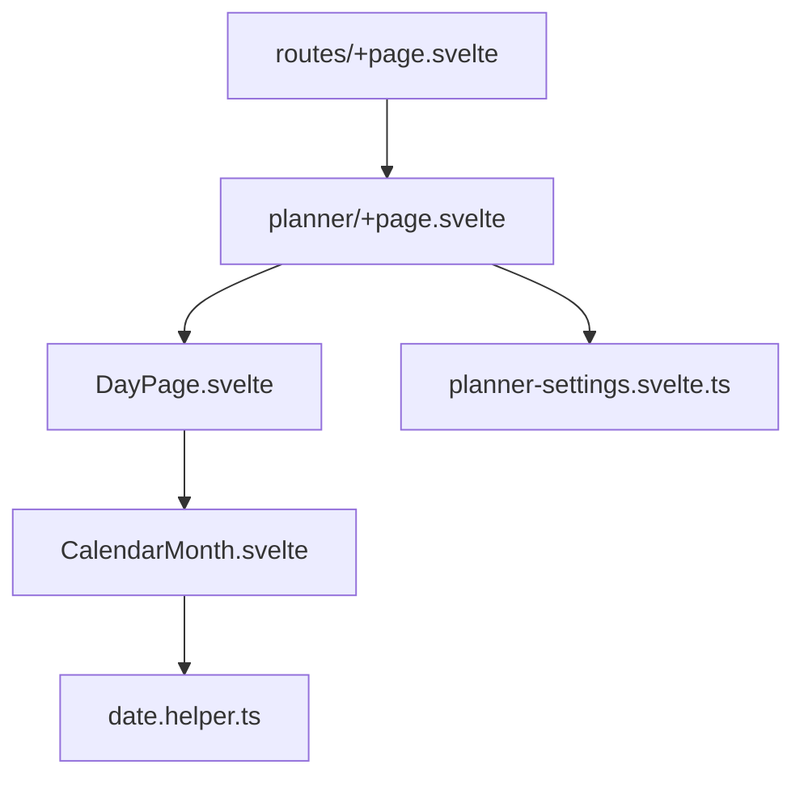

# brianschwabauer/remarkably-organized

> Web application that generates customizable PDF planners for e-ink tablets such as the Remarkable 2.

## The problem
E-ink tablets have no suitable planner; a custom PDF with internal links is needed.

## What it actually does
Settings (modal) produce a live preview and are stored in the URL for sharing. Export is done through Chrome's PDF print with "Background Graphics". Svelte and Vite.

## How it is wired


## Trying it
```bash
pnpm i
pnpm run dev
pnpm run build
```

## Cost and gotchas
Free. pnpm and Node required; large PDFs use a lot of memory in Chrome. Last push in January 2025.

## What it is not
Not a synced planner: the "Today" button and ICS import remain future ideas.

## Alternatives
No alternative named in the README.

## For you
Ignore: personal productivity utility outside the data/AI scope, little activity.
