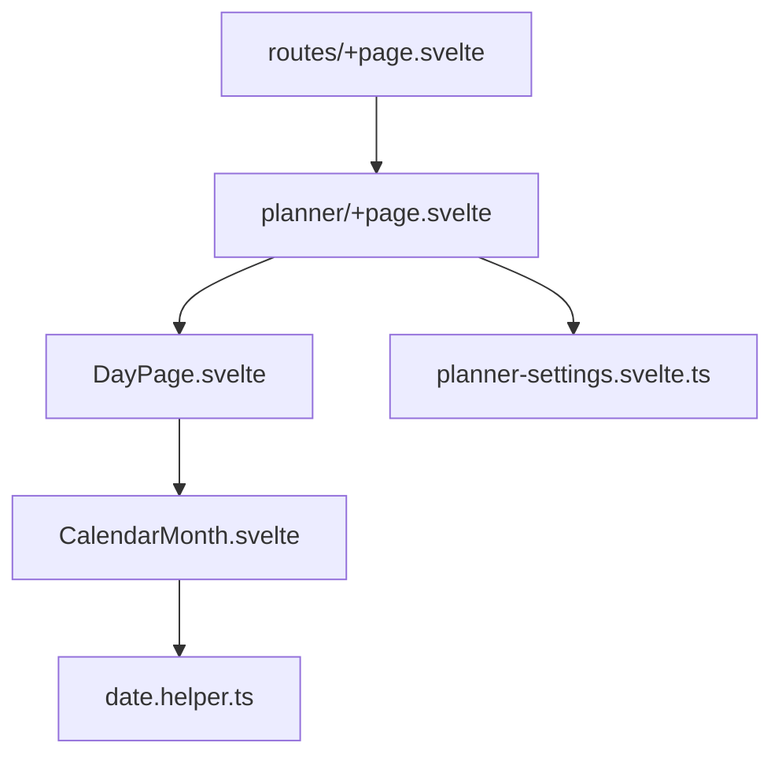

# brianschwabauer/remarkably-organized

> Application web qui génère des agendas PDF personnalisables pour tablettes e-ink comme la Remarkable 2.

## Le problème
Les tablettes e-ink n'ont pas d'agenda adapté ; il faut un PDF avec liens internes sur mesure.

## Ce que ça fait vraiment
Les réglages (modale) produisent un aperçu en direct et sont stockés dans l'URL pour partager. L'export se fait par l'impression PDF de Chrome avec « Background Graphics ». Svelte et Vite.

## Comment c'est branché


## Essayer
```bash
pnpm i
pnpm run dev
pnpm run build
```

## Coût et pièges
Gratuit. pnpm et Node requis ; les grands PDF consomment beaucoup de mémoire dans Chrome. Dernier push en janvier 2025.

## Ce que ce n'est pas
Pas un agenda synchronisé : le bouton « Today » et l'import ICS restent des idées futures.

## Alternatives
Aucune alternative nommée dans le README.

## Pour toi
À ignorer : utilitaire de productivité personnelle hors périmètre data/IA, peu actif.

