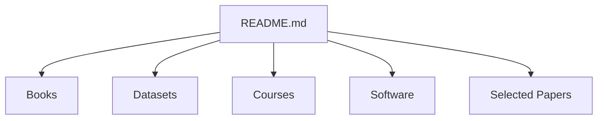

# briatte/awesome-network-analysis

> Annotated list of resources for building, analyzing and visualizing network data.

## The problem
The literature and tools for network analysis are scattered across sociology, physics and computer science.

## What it actually does
It is an index of books, conferences, courses, datasets, journals, research groups, review articles and software (C/C++, Java, JavaScript, Julia, MATLAB, Python, R, Stata). The datasets cite, among others, KONECT, Network Repository and the Stanford Large Network Dataset Collection. Updated irregularly since 2016.

## How it is wired
Simplified diagram based on the sheet, no diagram provided.

## Trying it
No command documented: the list is read on GitHub.

## Cost and gotchas
Free. Many of the cited books are paid. The README provided is truncated, the Software section was not read.

## What it is not
It is not a tool or a tutorial. The links are not verified, and the list leans toward social sciences. No license is declared.

## Alternatives
No alternative named in the README.

## For you
Watch: a good entry point for finding graph datasets and courses, to consult when you work on graphs.
