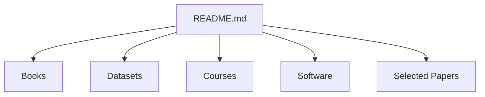

# briatte/awesome-network-analysis

> Liste commentée de ressources pour construire, analyser et visualiser des données de réseaux.

## Le problème
La littérature et les outils d'analyse de réseaux sont dispersés entre sociologie, physique et informatique.

## Ce que ça fait vraiment
C'est un index de livres, conférences, cours, jeux de données, revues, groupes de recherche, articles de synthèse et logiciels (C/C++, Java, JavaScript, Julia, MATLAB, Python, R, Stata). Les jeux de données citent entre autres KONECT, Network Repository et le Stanford Large Network Dataset Collection. Mise à jour irrégulière depuis 2016.

## Comment c'est branché
Schéma simplifié d'après la fiche, sans diagramme fourni.

## Essayer
Aucune commande documentée : la liste se lit sur GitHub.

## Coût et pièges
Gratuit. Beaucoup de livres cités sont payants. Le README fourni est tronqué, la section Software n'a pas été lue.

## Ce que ce n'est pas
Ce n'est pas un outil ni un tutoriel. Les liens ne sont pas vérifiés, et la liste penche vers les sciences sociales. Aucune licence n'est déclarée.

## Alternatives
Aucune alternative nommée dans le README.

## Pour toi
Surveiller : bonne porte d'entrée pour trouver des jeux de données de graphes et des cours, à consulter quand tu travailles sur des graphes.

