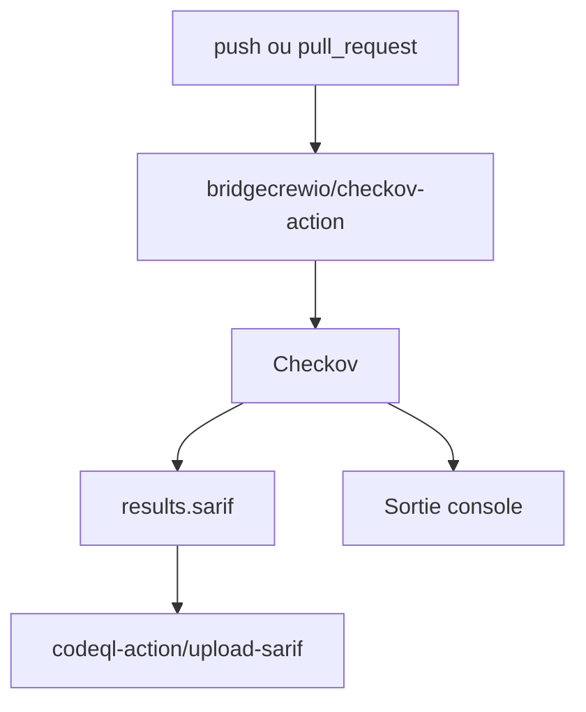

# bridgecrewio/checkov-action

> GitHub Action that runs Checkov to find misconfigurations in infrastructure-as-code and images.

## The problem
Terraform, Kubernetes or Docker misconfigurations reach production for lack of automatic checks in CI.

## What it actually does
Runs Checkov on your repository: IaC, open-source packages, container images and CI/CD configurations. Options: pick or skip checks, filter by framework, baseline file, CLI or SARIF outputs for GitHub's security tab. Private Terraform modules go through a GitHub token.

## How it is wired


## Trying it
```yaml
- uses: actions/checkout@v3
- name: Checkov GitHub Action
  uses: bridgecrewio/checkov-action@v12
  with:
    output_format: cli,sarif
    output_file_path: console,results.sarif
```

## Cost and gotchas
Nothing to install outside GitHub Actions. Image checks require a Docker build and, depending on the example, a Bridgecrew key (`BC_API_KEY`) stored as a secret. Failing scans fail the job, unless `soft_fail` is set.

## What it is not
Not the scanner itself: it is the GitHub Action wrapper around Checkov. The `--check` and `--skip-check` check IDs must be mutually exclusive.

## Alternatives
No alternative named in the README.

## For you
Adopt it if you version infrastructure (Terraform, Kubernetes, Dockerfiles): three lines of CI are enough for a security check.
