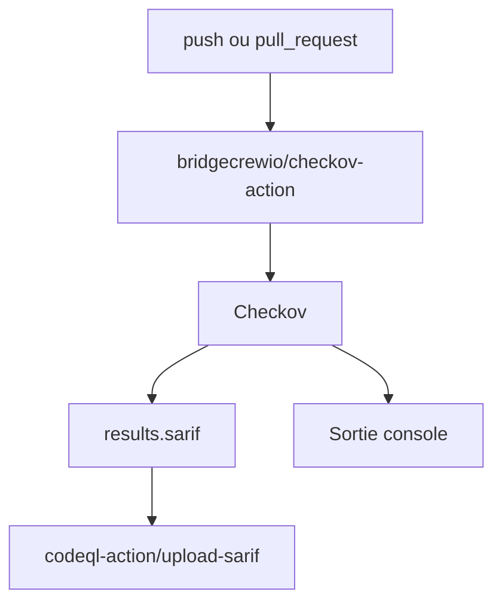

# bridgecrewio/checkov-action

> GitHub Action qui lance Checkov pour trouver les erreurs de configuration dans l'infrastructure-as-code et les images.

## Le problème
Les erreurs de configuration Terraform, Kubernetes ou Docker passent en production faute de contrôle automatique dans la CI.

## Ce que ça fait vraiment
Exécute Checkov sur ton dépôt : IaC, paquets open source, images de conteneurs et configurations CI/CD. Options : choisir ou ignorer des vérifications, filtrer par framework, fichier de base de référence, sorties CLI ou SARIF pour l'onglet sécurité de GitHub. Les modules Terraform privés passent par un jeton GitHub.

## Comment c'est branché


## Essayer
```yaml
- uses: actions/checkout@v3
- name: Checkov GitHub Action
  uses: bridgecrewio/checkov-action@v12
  with:
    output_format: cli,sarif
    output_file_path: console,results.sarif
```

## Coût et pièges
Rien à installer hors GitHub Actions. Les contrôles d'images demandent un build Docker et, selon l'exemple, une clé Bridgecrew (`BC_API_KEY`) stockée en secret. Les scans en échec font échouer le job, sauf `soft_fail`.

## Ce que ce n'est pas
Pas le scanner lui-même : c'est l'enveloppe GitHub Action de Checkov. Les ID de vérifications `--check` et `--skip-check` doivent s'exclure mutuellement.

## Alternatives
Aucune alternative nommée dans le README.

## Pour toi
Adopter si tu versionnes de l'infrastructure (Terraform, Kubernetes, Dockerfiles) : trois lignes de CI suffisent pour un contrôle de sécurité.

