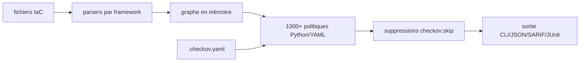

# bridgecrewio/checkov

> Static analysis of infrastructure as code and dependency scanning, over 1000 policies.

## The problem
A cloud misconfiguration (public bucket, missing encryption) is discovered after deployment, when it is already exploitable.

## What it actually does
Scans Terraform, Terraform plan, CloudFormation, SAM, Kubernetes, Helm, Kustomize, Dockerfile, Serverless, Ansible, Bicep, ARM, OpenTofu, OpenAPI.
Also scans CI pipelines: Argo Workflows, Azure Pipelines, BitBucket, CircleCI, GitHub Actions, GitLab CI.
In-memory graph analysis, with evaluation of variables and their default values.
Detects AWS credentials in EC2 userdata, Lambda variables and providers; finds secrets by regex, keywords and entropy.

## How it is wired


## Trying it
```sh
pip3 install checkov
checkov --directory /user/path/to/iac/code
checkov -f tf.json --repo-root-for-plan-enrichment /user/path/to/iac/code
docker run --tty --rm --volume /user/tf:/tf --workdir /tf bridgecrew/checkov --directory /tf
```

## Cost and gotchas
The core is free, but severity filtering (`--check MEDIUM`), SCA scanning and image scanning require `--bc-api-key`. Python 3.9 to 3.12 only. Checkov calls the Prisma Cloud API to enrich results: use `--skip-download` to disable.

## What it is not
Not a runtime scanner: it reads files, not a live cluster. The README recalls the limit of any static analysis: a manually managed resource will produce false positives to suppress by annotation. The config file must come from a trusted source, since it loads custom checks.

## Alternatives
No named alternative; the README only cites Prisma Cloud, of which Checkov is the open-source building block.

## For you
Plug it into pre-commit or CI as soon as you write Terraform or Kubernetes manifests.
