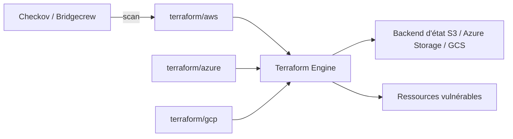

# bridgecrewio/terragoat

> Deliberately vulnerable Terraform repository for practicing the detection of cloud misconfigurations (AWS, Azure, GCP).

## The problem
IaC misconfigurations reach production unnoticed. A realistic training ground is missing to test scanners and policies.

## What it actually does
Provides Terraform stacks per cloud (aws, azure, gcp, alicloud, oracle) full of bad practices: public buckets, missing encryption, hardcoded secrets, open ports. Serves as a target for Checkov, pre-commit hooks or linters. The README lists the results of an automatic scan. Can be genuinely deployed in a cloud account.

## How it is wired


## Trying it
```bash
cd terraform/aws/
terraform init \
-backend-config="bucket=$TERRAGOAT_STATE_BUCKET" \
-backend-config="key=$TF_VAR_company_name-$TF_VAR_environment.tfstate" \
-backend-config="region=$TF_VAR_region"
terraform apply
terraform destroy
```

## Cost and gotchas
Creates real billed resources in your account; the README forbids putting them in production or near sensitive data. A state storage bucket/account must exist beforehand, and the aws/azure/gcloud CLIs are needed.

## What it is not
Not a scanner: it is the target to scan. The last push dates from July 2025 and the announced Terraform version (0.12) is old.

## Alternatives
- The other "Goat" projects cited: CfnGoat, CDKGoat, kustomizegoat (same idea, different IaC format).
- Checkov: the scanning tool the README pairs it with.

## For you
Mostly useful if you do IaC security / cloud MLOps and want a test bench for Checkov; otherwise worth watching, since it is barely active and has no direct data interest.
