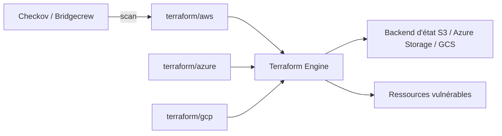

# bridgecrewio/terragoat

> Dépôt Terraform volontairement vulnérable pour s'entraîner à détecter des erreurs de configuration cloud (AWS, Azure, GCP).

## Le problème
Les erreurs de configuration IaC arrivent en production sans qu'on les voie. Il manque un terrain d'entraînement réaliste pour tester scanners et politiques.

## Ce que ça fait vraiment
Fournit des stacks Terraform par cloud (aws, azure, gcp, alicloud, oracle) pleines de mauvaises pratiques : buckets publics, chiffrement absent, secrets en dur, ports ouverts. Sert de cible pour Checkov, hooks pre-commit ou linters. Le README liste les résultats d'un scan automatique. Déployable pour de vrai dans un compte cloud.

## Comment c'est branché


## Essayer
```bash
cd terraform/aws/
terraform init \
-backend-config="bucket=$TERRAGOAT_STATE_BUCKET" \
-backend-config="key=$TF_VAR_company_name-$TF_VAR_environment.tfstate" \
-backend-config="region=$TF_VAR_region"
terraform apply
terraform destroy
```

## Coût et pièges
Crée de vraies ressources facturées dans ton compte ; le README interdit de les mettre en production ou près de données sensibles. Il faut un bucket/compte de stockage d'état préalable et les CLI aws/azure/gcloud.

## Ce que ce n'est pas
Pas un scanner : c'est la cible à scanner. Le dernier push date de juillet 2025 et la version Terraform annoncée (0.12) est ancienne.

## Alternatives
- Les autres projets « Goat » cités : CfnGoat, CDKGoat, kustomizegoat (même idée, autre format d'IaC).
- Checkov : l'outil de scan que le README associe.

## Pour toi
Utile surtout si tu fais de la sécurité IaC / MLOps cloud et veux un banc d'essai pour Checkov ; sinon à surveiller, car peu actif et sans intérêt data direct.

