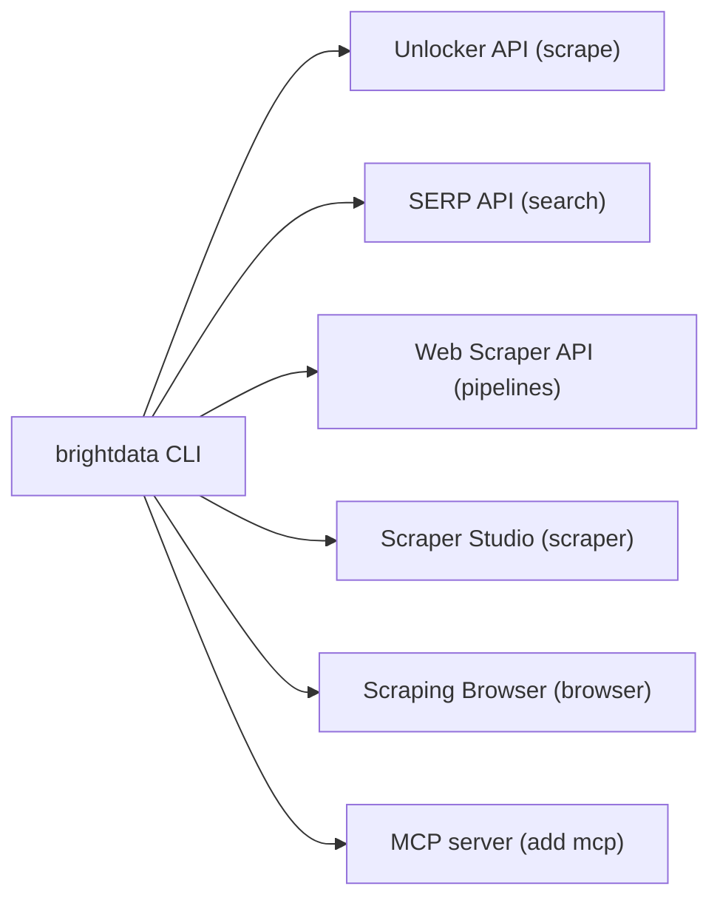

# brightdata/cli

> Bright Data's official CLI for scraping, searching and extracting web data from the terminal.

## The problem
Collecting structured web data means handling proxies, JavaScript rendering and anti-bot measures, and juggling several APIs.

## What it actually does
The `brightdata` command (alias `bdata`) calls the service's APIs: `scrape`, `search` (Google, Bing, Yandex), `discover`, `pipelines` (ready-made scrapers), `scraper create/run/heal` (AI-generated scrapers) and `browser`. It can also install Bright Data's MCP server into a coding agent.

## How it is wired

Simplified diagram based on the sheet, no diagram provided.

## Trying it
```bash
npm install -g @brightdata/cli
brightdata init
brightdata scrape https://example.com
brightdata search "web scraping best practices"
brightdata budget
```

## Cost and gotchas
An API key and a Bright Data account are required. Free tier of 5,000 credits per month, but Browser API and proxies are excluded from it. Every request and every record consumes credits. Node.js 20 or later.

## What it is not
It is not a local scraper: everything goes through Bright Data's paid service. The README (truncated here) does not document all of `browser`.

## Alternatives
The README names none.

## For you
Worth watching: handy for feeding a data pipeline or an agent with web pages, but you depend on a paid provider.
