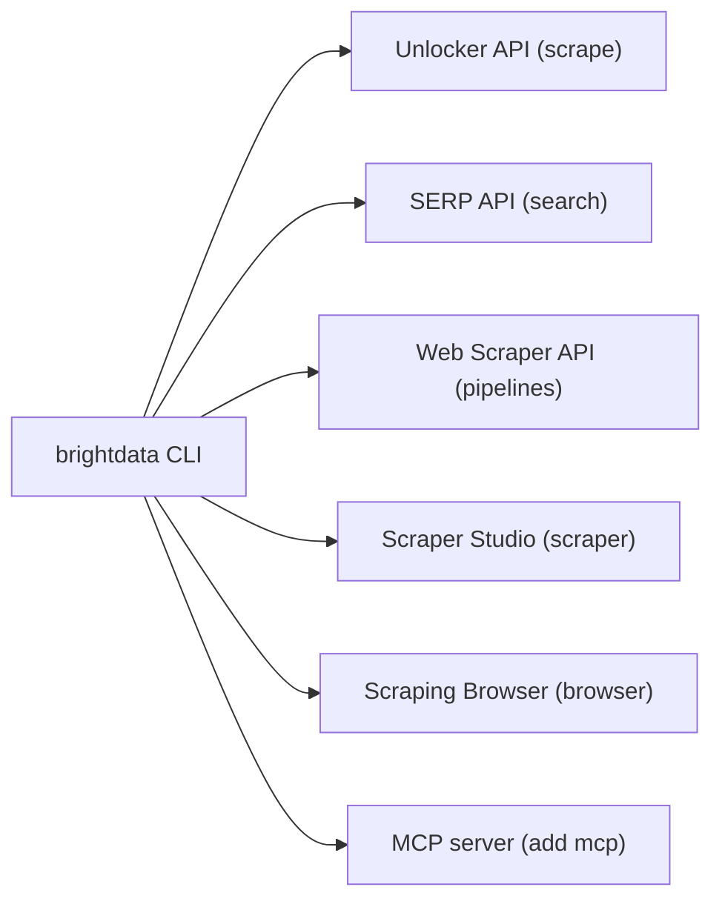

# brightdata/cli

> CLI officielle de Bright Data pour scraper, chercher et extraire des données web depuis le terminal.

## Le problème
Collecter des données web structurées demande de gérer proxys, rendu JavaScript et anti-bot, et de jongler avec plusieurs API.

## Ce que ça fait vraiment
La commande `brightdata` (alias `bdata`) appelle les API du service : `scrape`, `search` (Google, Bing, Yandex), `discover`, `pipelines` (scrapers prêts à l'emploi), `scraper create/run/heal` (scrapers générés par IA) et `browser`. Elle sait aussi installer le serveur MCP de Bright Data dans un agent de code.

## Comment c'est branché

Schéma simplifié d'après la fiche, sans diagramme fourni.

## Essayer
```bash
npm install -g @brightdata/cli
brightdata init
brightdata scrape https://example.com
brightdata search "web scraping best practices"
brightdata budget
```

## Coût et pièges
Clé d'API et compte Bright Data obligatoires. Palier gratuit de 5 000 crédits par mois, mais Browser API et proxys en sont exclus. Chaque requête et chaque enregistrement consomment des crédits. Node.js 20 ou plus.

## Ce que ce n'est pas
Ce n'est pas un scraper local : tout passe par le service payant de Bright Data. Le README (tronqué ici) ne documente pas tout `browser`.

## Alternatives
Le README n'en nomme aucune.

## Pour toi
À surveiller : pratique pour alimenter un pipeline de données ou un agent en pages web, mais tu dépends d'un fournisseur payant.

