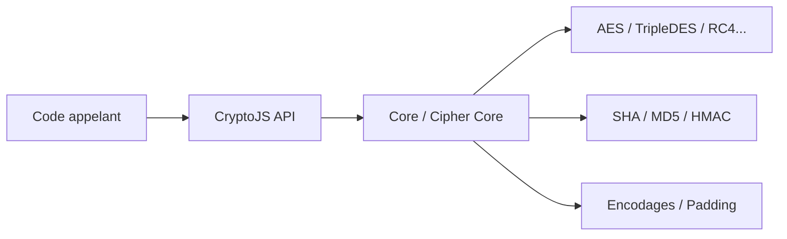

# brix/crypto-js

> JavaScript library of cryptographic standards, abandoned, to be replaced by the native `crypto` module.

## The problem
Hashing and encryption were needed in JavaScript before browsers and Node had a native API.

## What it actually does
Separately importable modules: AES, TripleDES, RC4, Rabbit, Blowfish, MD5/SHA-1/SHA-2/SHA-3/RIPEMD160 hashes, HMAC, PBKDF2, Base64/UTF-16 encodings, modes and paddings. Since 4.0.0, randomness comes from the native `crypto` module. Version 4.2.0 changed the default PBKDF2 algorithm and iterations.

## How it is wired


## Trying it
```bash
npm install crypto-js
```
```javascript
var CryptoJS = require("crypto-js");
var ciphertext = CryptoJS.AES.encrypt('my message', 'secret key 123').toString();
```

## Cost and gotchas
Development has stopped (the README says so). A license is present but not identified by GitHub. The 3.1.x versions used `Math.random()`, which is unsafe; 3.2.0 is flagged as not to be used.

## What it is not
It is not a maintained library, nor one recommended for new code.

## Alternatives
The native `crypto` module of Node and browsers, recommended by the README itself.

## For you
Ignore: the project is discontinued, the license is unclear, and the author himself points to the native API, which is safer for any new code.
