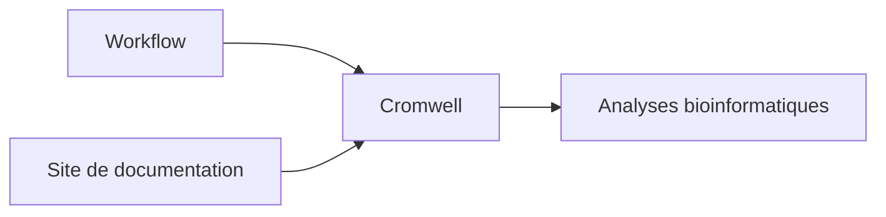

# broadinstitute/cromwell

> Workflow engine for bioinformatics, maintained by the Broad Institute.

## The problem
Chaining heavy bioinformatics analyses by hand is fragile and hard to reproduce.

## What it actually does
The README gives no detail: it announces a workflow management system for bioinformatics, under the BSD 3-Clause license, with a dedicated documentation site. The internal workings are not documented here.

## How it is wired
Simplified diagram based on the sheet, no diagram provided.

## Trying it
No command documented in the README. It points to the tutorials on the documentation site.

## Cost and gotchas
Free according to the license. Compute needs and deployment are not documented in the README.

## What it is not
Not a general-purpose orchestrator presented as such: the README describes it for bioinformatics. The supported workflow languages are not indicated here.

## Alternatives
No alternative named in the README.

## For you
Worth watching if you do bioinformatics or batch scientific computing; otherwise, nothing in the sheet justifies dwelling on it.
