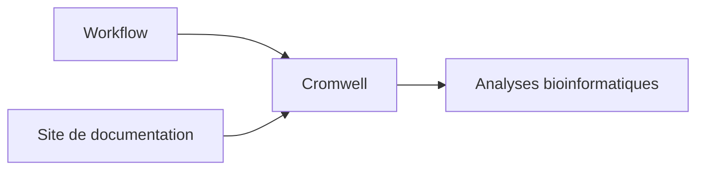

# broadinstitute/cromwell

> Moteur de workflows pour la bioinformatique, maintenu par le Broad Institute.

## Le problème
Enchaîner des analyses bioinformatiques lourdes à la main est fragile et peu reproductible.

## Ce que ça fait vraiment
Le README ne détaille rien : il annonce un système de gestion de workflows pour la bioinformatique, sous licence BSD 3-Clause, avec un site de documentation dédié. Le fonctionnement interne est non documenté ici.

## Comment c'est branché
Schéma simplifié d'après la fiche, sans diagramme fourni.

## Essayer
Aucune commande documentée dans le README. Il renvoie vers les tutoriels du site de documentation.

## Coût et pièges
Gratuit d'après la licence. Les besoins en calcul et le déploiement sont non documentés dans le README.

## Ce que ce n'est pas
Pas un orchestrateur généraliste présenté comme tel : le README le décrit pour la bioinformatique. Les langages de workflow pris en charge ne sont pas indiqués ici.

## Alternatives
Aucune alternative nommée dans le README.

## Pour toi
À surveiller si tu fais de la bioinformatique ou du calcul scientifique par lots ; sinon, rien dans la fiche ne justifie de s'y attarder.

