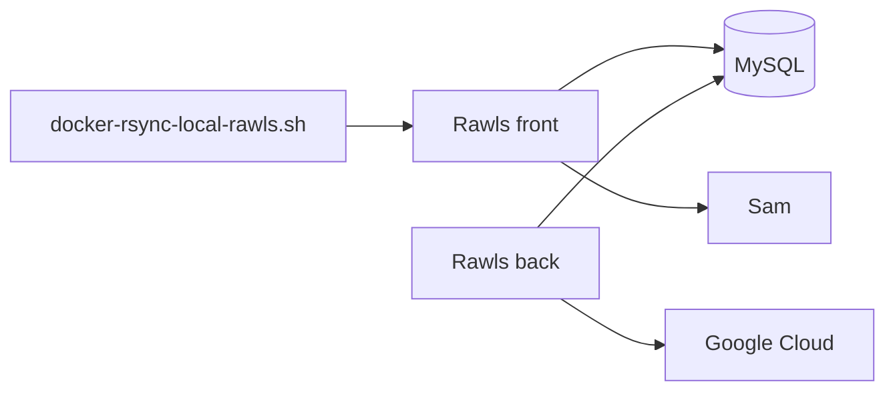

# broadinstitute/rawls

> Scala manager of workspaces, entities, submissions and method configurations for the Terra platform.

## The problem
Terra needs a central service that manages workspaces, data and analysis launches.

## What it actually does
API service from the Broad Institute. "Front" instance: serves HTTP requests. "Back" instance: additionally runs submission monitoring, PFB imports and Google billing project creation. Models are published in Google Artifact Registry.

## How it is wired


## Trying it
```bash
./local-dev/bin/render
./config/docker-rsync-local-rawls.sh
BACK_RAWLS=true ./config/docker-rsync-local-rawls.sh
```

## Cost and gotchas
Free, but running locally requires the Broad's network or VPN, Docker (8 GB or more), gcloud, kubectl and access to a dev database. Scala/sbt required.

## What it is not
Not usable outside the Broad's Terra infrastructure.

## Alternatives
No alternative named in the README.

## For you
Ignore: internal Terra component, unusable outside the Broad's infrastructure.
