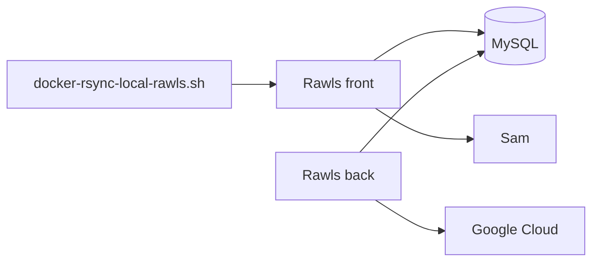

# broadinstitute/rawls

> Gestionnaire Scala d'espaces de travail, entités, soumissions et configurations de méthodes pour la plateforme Terra.

## Le problème
Terra a besoin d'un service central qui gère espaces de travail, données et lancements d'analyses.

## Ce que ça fait vraiment
Service d'API du Broad Institute. Instance « front » : sert les requêtes HTTP. Instance « back » : exécute en plus la surveillance des soumissions, les imports PFB et la création de projets de facturation Google. Les modèles sont publiés dans Google Artifact Registry.

## Comment c'est branché


## Essayer
```bash
./local-dev/bin/render
./config/docker-rsync-local-rawls.sh
BACK_RAWLS=true ./config/docker-rsync-local-rawls.sh
```

## Coût et pièges
Gratuit, mais l'exécution locale exige le réseau du Broad ou son VPN, Docker (8 Go ou plus), gcloud, kubectl et l'accès à une base de dev. Scala/sbt requis.

## Ce que ce n'est pas
Pas utilisable en dehors de l'infrastructure Terra du Broad.

## Alternatives
Aucune alternative nommée dans le README.

## Pour toi
À ignorer : brique interne de Terra, inexploitable hors de l'infrastructure du Broad.

