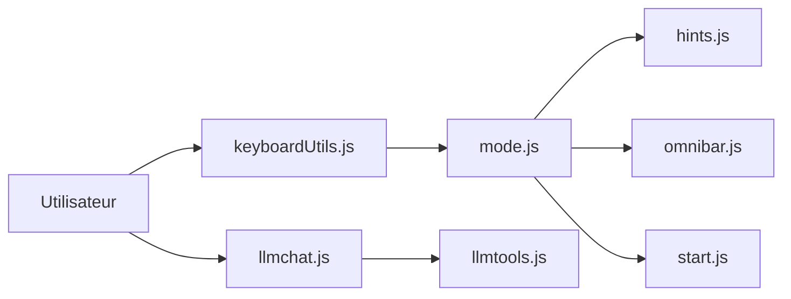

# brookhong/Surfingkeys

> Browser extension for Vim-style keyboard navigation, configurable in JavaScript.

## The problem
Keyboard navigation on the web is limited to the browser's shortcuts, and every site imposes its own.

## What it actually does
Normal, visual and insert modes, link hints, omnibar, marks, sessions, built-in Vim editor, Markdown preview, PDF viewer, proxy. All settings are JavaScript (`api.mapkey`). An LLM chat (key `A`) talks to Ollama, Bedrock or any OpenAI-compatible API with your own credentials; every browser tool call is confirmed by the user.

## How it is wired


## Trying it
```bash
# installer depuis le Chrome Web Store, Firefox Add-ons, Edge ou Mac App Store
# puis dans une page : ? pour l'aide, f pour suivre un lien, A pour le chat LLM
```

## Cost and gotchas
Free. The LLM chat requires credentials in `settings.llm`. Some features are missing on Firefox and Safari; loading settings from a local file requires a native host.

## What it is not
Not a browser automation tool or a scraper. Chrome restricts some keys, hence a dedicated Chromium build is mentioned. 426 open issues.

## Alternatives
vimium and cVim: cited in the credits as predecessors.

## For you
Worth watching: a navigation comfort for reading docs and papers, with no data/AI stakes; the LLM chat is an optional bonus.
