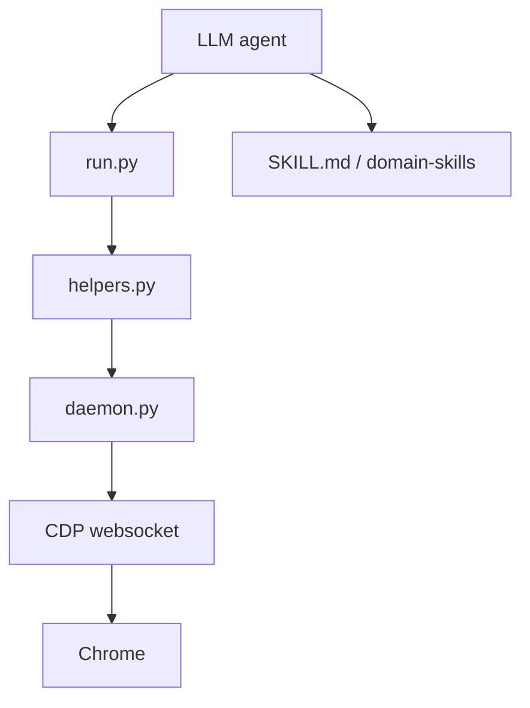

# browser-use/browser-harness

> Minimal CDP bridge between an LLM agent and your real Chrome, which the agent extends itself.

## The problem
Automation frameworks freeze the possible actions. They often lack upload, iframes or an already logged-in session.

## What it actually does
The Python code connects to Chrome through a CDP websocket thanks to `admin.py` and `daemon.py`.
The agent goes through `helpers.py`. When an action is missing, it writes the helper itself in its workspace.
Markdown playbooks `interaction-skills/` and `domain-skills/` serve as memory.
An MCP server, `browser-harness-mcp`, is provided.

## How it is wired

## Trying it
The README gives no shell command: installation goes through an instruction to paste into Claude Code or Codex (uv, Python 3.12), then `chrome://inspect/#remote-debugging`.

## Cost and gotchas
It is free locally. To scale to several browsers, you need Browser Use Cloud, which is paid. The agent drives your logged-in browser and therefore has access to your sessions.

## What it is not
The README is very short, hence a partial sheet. Not a reproducible test framework: helpers change from one task to another.

## Alternatives
The README names no alternative repository.

## For you
Worth watching: the idea of a self-modifying harness is interesting for web agents, but giving it control of your own Chrome is a risk to weigh.
