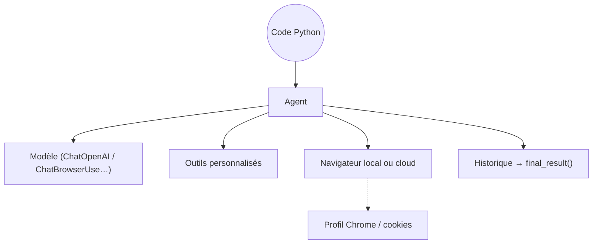

# browser-use/browser-use

> Python library that gives an LLM control over a real web browser, under the MIT license.

## The problem
Many data sources are only accessible through a web interface, behind a form or session.
Write a Playwright script that triggers whenever the page changes.

## What it actually does
An `Agent(task=..., llm=...)` object controls either a local or remote browser until the task is completed.
The system prompt is provided by the library; it can be extended or replaced.
Custom tools can be saved via `Tools()` and a `@tools.action` decorator.
Three usage modes: fully hosted cloud, CLI connected to an existing agent, and a Python library.

## How it is wired


## Trying it
```bash
uv add browser-use
uv run agent.py
```
```python
from browser_use import Agent, ChatOpenAI
agent = Agent(task="Find the number of stars of the browser-use repo", llm=ChatOpenAI(model='gpt-5.6-luna'))
```

## Cost and gotchas
Python ≥ 3.11. The library is free; inference and cloud-based browsers are paid for (~$0.02/hour for the browser).
Circumvent CAPTCHAs and maintain anonymity through the paid service – no guarantee of success.

## What it is not
Not a scraper: each action consumes tokens, so the cost increases with the number of pages.
Not deterministic: an LLM agent can click in the wrong place and produce an irreversible action.
Profile synchronization only transfers cookies, not localStorage or extensions.

## Alternatives
- `D4Vinci/Scrapling`: This option is more cost-effective and predictable when the page structure is stable.
- `unclecode/crawl4ai`: to retrieve content in Markdown format without needing to control an agent.

## For you
This is intended for situations where no script is available; otherwise, the cost per page becomes excessive.
