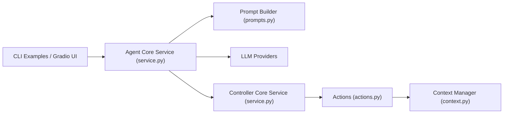

# browser-use/macOS-use

> Python library in which an LLM agent drives the applications on a Mac, for experimenters.

## The problem
Automating tasks in macOS applications that have no API, purely through the graphical interface.

## What it actually does
An agent builds a prompt and queries an LLM (OpenAI, Anthropic or Gemini), then a controller finds the action in a registry and triggers it through the `mac` module (actions, UI element tree). It loops until `done` is called. Examples in CLI and a small Gradio interface; a telemetry module is present in the code.

## How it is wired


## Trying it
```bash
pip install mlx-use
git clone https://github.com/browser-use/macOS-use.git && cd macOS-use
cp .env.example .env
brew install uv && uv venv && source .venv/bin/activate
uv pip install --editable . && python examples/try.py
```

## Cost and gotchas
OpenAI, Anthropic or Gemini API key at your expense; macOS required. The README warns: the agent may use your credentials and does not stop at CAPTCHAs.

## What it is not
Not a supervised or safe tool: "do not use it unattended". Local MLX inference is a vision, not a shipped feature. Last push in March 2025.

## Alternatives
No alternative named in the README.

## For you
Ignore: an early-stage project with no update in over a year, with real risks to the machine's credentials.
