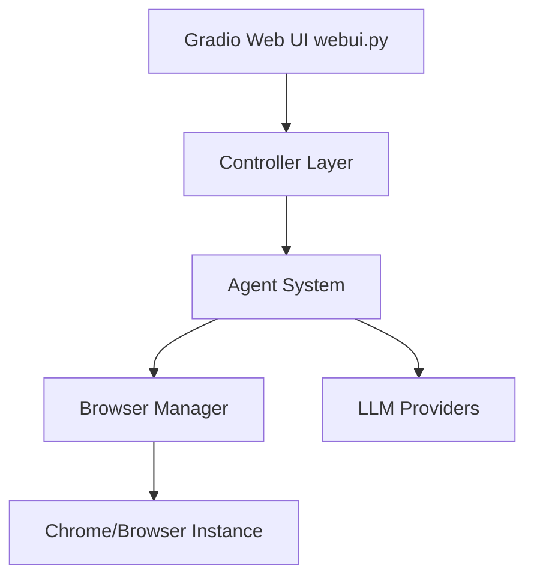

# browser-use/web-ui

> Gradio interface for driving a browser-use agent on your own browser.

## The problem
Testing an agent that browses the web without writing code, using your own already-open sessions, is not simple.

## What it actually does
A Gradio interface on top of `browser-use`.
It accepts several LLMs: Google, OpenAI, Azure, Anthropic, DeepSeek, Ollama.
It can use your Chrome (`BROWSER_PATH`, `BROWSER_USER_DATA`), with a persistent session and screen recording.
In Docker mode, a VNC on port 6080 lets you watch the agent work.

## How it is wired


## Trying it
```bash
git clone https://github.com/browser-use/web-ui.git
uv venv --python 3.11
uv pip install -r requirements.txt
playwright install --with-deps
python webui.py --ip 127.0.0.1 --port 7788
docker compose up --build
```

## Cost and gotchas
LLM keys are at your expense. The default VNC password (`youvncpassword`) must be changed.

## What it is not
It is not a library: it is a demo on top of browser-use. It is not meant to run unsupervised in production.

## Alternatives
The README only names `browser-use`, of which this is the interface.

## For you
Worth watching: handy for prototyping a web agent in a few minutes, but the real subject remains the browser-use library underneath.
