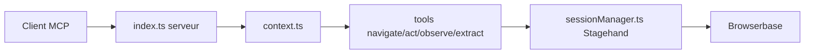

# browserbase/mcp-server-browserbase

> Archived MCP server that drives a Browserbase cloud browser via Stagehand.

## The problem
Letting an LLM browse, observe and extract data from web pages through a standard protocol.

## What it actually does
Exposes six MCP tools (`start`, `end`, `navigate`, `act`, `observe`, `extract`) that drive Browserbase sessions with Stagehand. STDIO and HTTP transports. The default model is Gemini 2.5 Flash Lite, replaceable with `--modelName` and `--modelApiKey`. The README states the repo is archived and unmaintained, and recommends the hosted version.

## How it is wired


## Trying it
```bash
npx @browserbasehq/mcp
git clone https://github.com/browserbase/mcp-server-browserbase.git
cd mcp-server-browserbase
npm install && npm run build
```
Required variables: `BROWSERBASE_API_KEY`, `BROWSERBASE_PROJECT_ID`, `GEMINI_API_KEY`.

## Cost and gotchas
Browserbase account and keys at your expense; the proxies and Verified options depend on the plan (Verified: Scale plan). Repo archived, so no more fixes.

## What it is not
Not representative of Browserbase's current services, according to the README itself.

## Alternatives
- Browserbase's hosted MCP server (`https://mcp.browserbase.com/mcp`): recommended by the README.

## For you
Ignore: archived and tied to a paid service; prefer the hosted version or a local browser.
