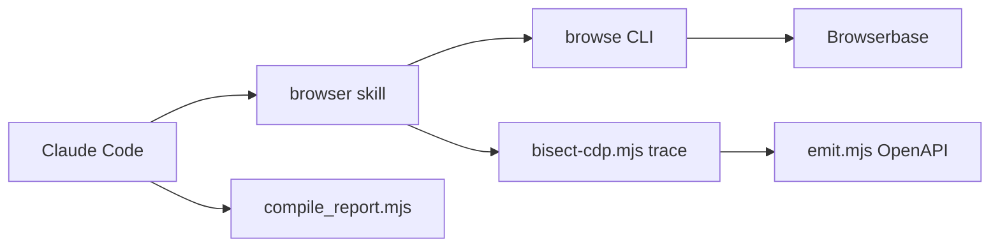

# browserbase/skills

> Claude Code plugin of browser automation skills via Browserbase and the `browse` CLI.

## The problem
A coding agent does not browse the web, test a UI or carry out business research without dedicated tools.

## What it actually does
About twenty skills: browser control (remote Browserbase or local sessions), serverless functions, CDP trace capture, generation of an OpenAPI spec from traffic, automatic navigation improvement, adversarial UI tests, WebMCP, Chrome cookie synchronization, `fetch` and `search`, and three business research workflows (companies, events, competitors). Works with `.mjs` scripts.

## How it is wired


## Trying it
```bash
npx skills add browserbase/skills
/plugin marketplace add browserbase/skills
/plugin install browse@browserbase
```

## Cost and gotchas
Remote sessions, residential proxies, CAPTCHAs and identity verification go through a Browserbase account; the README does not give pricing. No license declared in the catalog.

## What it is not
Not independent of the SaaS: many skills assume Browserbase. The `--local` mode avoids the cloud for localhost tests.

## Alternatives
No alternative cited in the README.

## For you
Ignore: tied to a commercial service and unlicensed, while local browser automation is enough for most data needs.
