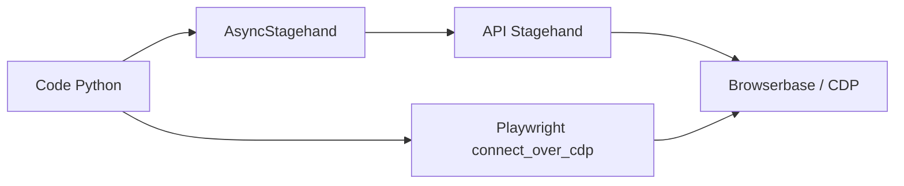

# browserbase/stagehand-python

> Python SDK to drive a browser in natural language and in code through Browserbase's Stagehand API.

## The problem
Selenium or Playwright scripts break as soon as the page changes, and purely AI-driven agents are unpredictable.

## What it actually does
A typed Python client (generated client, `Stagehand` and `AsyncStagehand`) that calls the Stagehand API: start a browser session (Browserbase), then `navigate`, `observe`, `act`, `extract` (with a schema) and `execute` (agent). Responses are read as SSE streams. The README promises action caching and self-healing.

## How it is wired


## Trying it
```bash
uv pip install stagehand
cp examples/.env.example examples/.env
uv run python examples/remote_browser_playwright_example.py
```

## Cost and gotchas
Two keys: `BROWSERBASE_API_KEY` and `MODEL_API_KEY` (billed LLM). The client calls `https://api.stagehand.browserbase.com` by default.

## What it is not
Not the engine: it is a client of the API. The repository is archived, so no fixes are coming; the README does not say what replaces it.

## Alternatives
The README mentions Selenium, Playwright and Puppeteer, which are lower level, and points to the project's other languages.

## For you
Ignore: archived repository that requires a paid third-party service; start from the repository that replaced it, which the README does not name.
