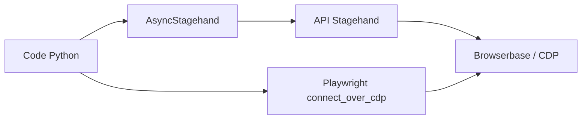

# browserbase/stagehand-python

> SDK Python pour piloter un navigateur en langage naturel et en code via l'API Stagehand de Browserbase.

## Le problème
Les scripts Selenium ou Playwright cassent dès que la page change, et les agents purement IA sont imprévisibles.

## Ce que ça fait vraiment
Un client Python typé (client généré, `Stagehand` et `AsyncStagehand`) qui appelle l'API Stagehand : démarrer une session navigateur (Browserbase), puis `navigate`, `observe`, `act`, `extract` (avec schéma) et `execute` (agent). Les réponses se lisent en streaming SSE. Le README promet mise en cache des actions et auto-réparation.

## Comment c'est branché


## Essayer
```bash
uv pip install stagehand
cp examples/.env.example examples/.env
uv run python examples/remote_browser_playwright_example.py
```

## Coût et pièges
Deux clés : `BROWSERBASE_API_KEY` et `MODEL_API_KEY` (LLM facturé). Le client appelle `https://api.stagehand.browserbase.com` par défaut.

## Ce que ce n'est pas
Pas le moteur : c'est un client de l'API. Le dépôt est archivé, donc sans corrections à venir ; le README n'indique pas son remplaçant.

## Alternatives
Le README cite Selenium, Playwright et Puppeteer, plus bas niveau, et renvoie vers d'autres langages du projet.

## Pour toi
À ignorer : dépôt archivé, qui exige un service tiers payant ; pars du dépôt qui l'a remplacé, que le README ne nomme pas.

