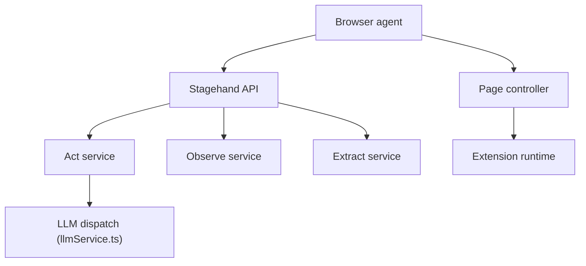

# browserbase/stagehand

> TypeScript, Python and Go SDK to drive a browser in natural language with LLM models.

## The problem
Browser automation scripts break as soon as a site changes, and giving a browser to an LLM wastes tokens.

## What it actually does
Three primitives: `act` (take an action), `observe` (returns real selectors, identifiers are not sent to the model) and `extract` (schema-validated data). Playwright-like API, server-side cache, `browse` CLI for coding agents. Works locally (Chrome) or on Browserbase.

## How it is wired


## Trying it
```bash
pnpm add @browserbasehq/stagehand 'zod@~4.4.3'
pip install stagehand
npm install -g browse
browse open https://example.com --local
```

## Cost and gotchas
Model API key (OpenAI in the example). Browserbase (cloud, hosted MCP) requires a paid key. Chrome required locally.

## What it is not
Not a ready-to-use autonomous agent: a toolbox. The speed figures in the README come from the vendor.

## Alternatives
None named in the README apart from Playwright (migration documented).

## For you
Worth watching: interesting for LLM-driven web extraction, with a dependency on the Browserbase cloud for scale.
