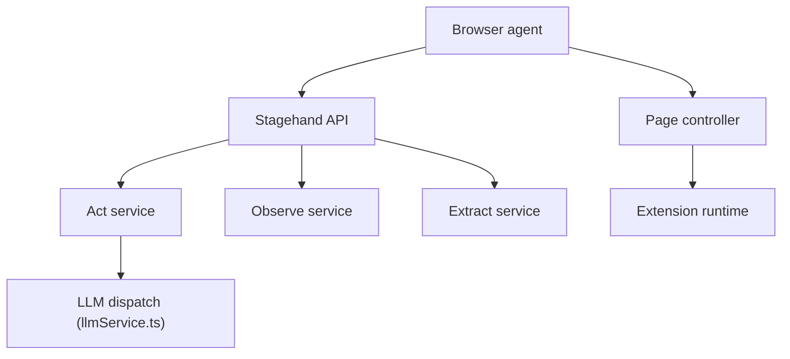

# browserbase/stagehand

> SDK TypeScript, Python et Go pour piloter un navigateur en langage naturel avec des modèles LLM.

## Le problème
Les scripts de navigation cassent dès qu'un site change, et donner un navigateur à un LLM gaspille des tokens.

## Ce que ça fait vraiment
Trois primitives : `act` (agir), `observe` (renvoie des sélecteurs réels, les identifiants ne vont pas au modèle) et `extract` (données validées par schéma). API de type Playwright, cache serveur, CLI `browse` pour agents de code. Fonctionne en local (Chrome) ou sur Browserbase.

## Comment c'est branché


## Essayer
```bash
pnpm add @browserbasehq/stagehand 'zod@~4.4.3'
pip install stagehand
npm install -g browse
browse open https://example.com --local
```

## Coût et pièges
Clé d'API du modèle (OpenAI dans l'exemple). Browserbase (cloud, MCP hébergé) demande une clé payante. Chrome requis en local.

## Ce que ce n'est pas
Pas un agent autonome prêt à l'emploi : une boîte à outils. Les chiffres de vitesse du README viennent de l'éditeur.

## Alternatives
Aucune nommée dans le README hors Playwright (migration documentée).

## Pour toi
À surveiller : intéressant pour de l'extraction web pilotée par LLM, avec une dépendance au cloud Browserbase pour l'échelle.

