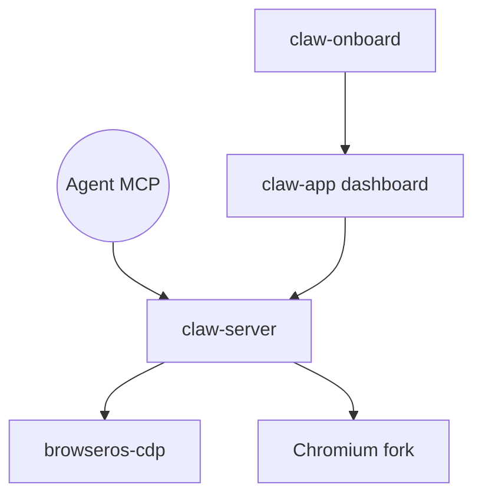

# browseros-ai/BrowserOS

> Secondary Chromium-based browser designed so your AI agents work with your real logged-in accounts.

## The problem
Headless browsers do not have your sessions, and cloud browsers get blocked by sites. Agents need a logged-in browser.

## What it actually does
A Chromium fork that imports your Chrome logins, exposes an MCP endpoint and lets agents (Claude Code, Codex, Cursor, VS Code, etc.) work in parallel in their own tabs. Live dashboard, video replay of each session. Sessions and history stay in `~/.browserclaw/`. The backend is in Rust, the interface in TypeScript.

## How it is wired


## Trying it
```sh
brew tap browseros-ai/tap
brew install --cask browseros-neo
```

## Cost and gotchas
Free, but you pay for the agents you connect. Sends anonymous usage events, which can be disabled in the settings. Giving your logins to agents means trusting them.

## What it is not
Not a Chrome replacement: a second browser. Not a headless driver for CI.

## Alternatives
- Playwright: better for CI without logged-in accounts.
- browser-use, browserbase: cloud browsers.

## For you
Worth watching: very handy to automate authenticated web tasks with your agents, provided you accept the risk of entrusting them with your sessions.
