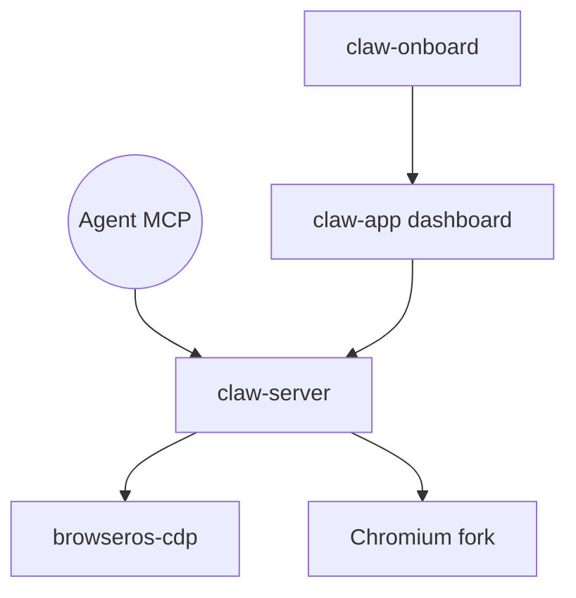

# browseros-ai/BrowserOS

> Navigateur secondaire basé sur Chromium, conçu pour que tes agents IA travaillent avec tes vrais comptes connectés.

## Le problème
Les navigateurs headless n'ont pas tes sessions, et les navigateurs cloud se font bloquer par les sites. Les agents ont besoin d'un navigateur connecté.

## Ce que ça fait vraiment
Fork de Chromium qui importe tes connexions Chrome, expose un endpoint MCP et laisse des agents (Claude Code, Codex, Cursor, VS Code, etc.) travailler en parallèle dans leurs onglets. Tableau de bord en direct, relecture vidéo de chaque session. Sessions et historique restent dans `~/.browserclaw/`. Le backend est en Rust, l'interface en TypeScript.

## Comment c'est branché


## Essayer
```sh
brew tap browseros-ai/tap
brew install --cask browseros-neo
```

## Coût et pièges
Gratuit, mais tu paies les agents que tu connectes. Envoie des événements d'usage anonymes, désactivables dans les réglages. Donner tes connexions à des agents suppose de leur faire confiance.

## Ce que ce n'est pas
Pas un remplaçant de Chrome : un second navigateur. Pas un pilote headless pour la CI.

## Alternatives
- Playwright : mieux pour la CI sans comptes connectés.
- browser-use, browserbase : navigateurs dans le cloud.

## Pour toi
À surveiller : très pratique pour automatiser des tâches web authentifiées avec tes agents, à condition d'accepter le risque de leur confier tes sessions.

