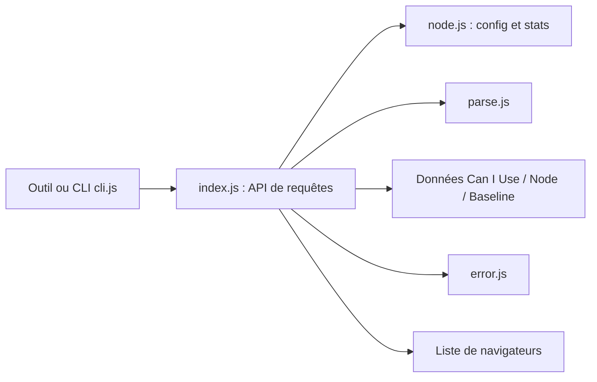

# browserslist/browserslist

> Shared configuration of the target browsers and Node.js versions, read by front-end tools.

## The problem
Every front-end tool (CSS prefixing, transpiler, linter) would want its own list of target browsers, hence inconsistencies.

## What it actually does
Reads a query (`.browserslistrc`, the `browserslist` key of `package.json` or the `BROWSERSLIST` variable), resolves it against Can I Use, Node.js and Baseline data, and returns the list of targeted versions. It also offers coverage calculation and custom usage statistics (Plausible, Google Analytics).

## How it is wired


## Trying it
```bash
npx browserslist
npx browserslist '> 0.3%, not dead'
browserslist --coverage "> 1%"
```

## Cost and gotchas
Free. The `caniuse-lite` data gets stale: you need to run `update-browserslist-db` regularly.

## What it is not
It is not a transpiler or a polyfill: it only lists targets. Other tools apply them.

## Alternatives
- browserslist-rs: a Rust port.
- browserslist-useragent: test a user-agent against a query.

## For you
Ignore for a data/AI profile: you will only touch it indirectly through front-end tooling, with nothing to configure.
