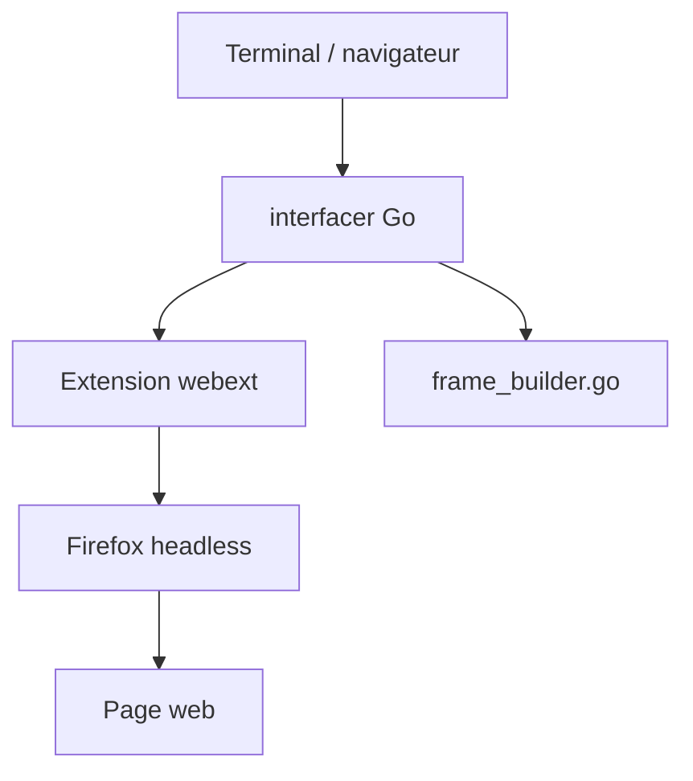

# browsh-org/browsh

> Text-mode browser backed by headless Firefox, rendered in a terminal or another browser.

## The problem
On a very slow connection, a graphical browser is unusable and classic text browsers handle neither JavaScript nor HTML5.

## What it actually does
A headless Firefox loads the page server-side; a Web extension converts the rendering into a text grid, and a Go program (`interfacer`) serves it to the terminal via TTY or to a browser. You can connect over SSH or Mosh, which saves bandwidth and battery. The browser client does not have feature parity with the terminal client.

## How it is wired


## Trying it
```bash
docker run --rm -it browsh/browsh
go run ./cmd/browsh --debug
```

## Cost and gotchas
Free. Firefox must be installed (~11 MB binary) or use the Docker image (~230 MB). Last push in July 2025.

## What it is not
Not a lightweight browser: it consumes a full Firefox, but somewhere other than on your machine.

## Alternatives
elinks (cited), which does not handle modern JavaScript, and VNC, less suited to very bad connections.

## For you
Ignore: a curiosity useful over SSH on a remote server, with no direct link to data/AI work.
