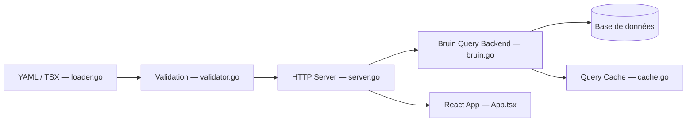

# bruin-data/dac

> Command-line tool for defining dashboards in YAML or TSX, versionable and reviewable.

## The problem
Dashboards are built by clicking in a BI interface: hard to review, to version and to have an AI agent produce reliably.

## What it actually does
DAC loads dashboards described in YAML or TSX, validates them, then serves them through a Go API and a React interface. A semantic layer (`semantic/`) defines metrics and dimensions once and generates the SQL. Queries go through `bruin query`, hence through your existing Bruin connections. It can also import from Metabase and export to static files or slides.

## How it is wired


## Trying it
```bash
curl -LsSf https://getbruin.com/install/dac | sh
dac init my-dashboards
cd my-dashboards
dac validate --dir .
dac serve --dir . --open
```

## Cost and gotchas
Free, but depends on the Bruin CLI (installed by the script) and on configured Bruin connections. Anonymous telemetry is on: can be disabled with `TELEMETRY_OPTOUT=1` or `DO_NOT_TRACK=1`.

## What it is not
Not a turnkey click-based BI tool: everything is code. AGPL-3.0 license: restrictive if you serve it as a modified SaaS. The README itself says query execution goes through an external call (`shells out`).

## Alternatives
Metabase: graphical interface, whose content DAC can import.

## For you
Worth watching: the "dashboard as code" idea, reviewable by an agent, is useful in data, but the project is less than a year old, depends on Bruin, and the AGPL may be a problem.
