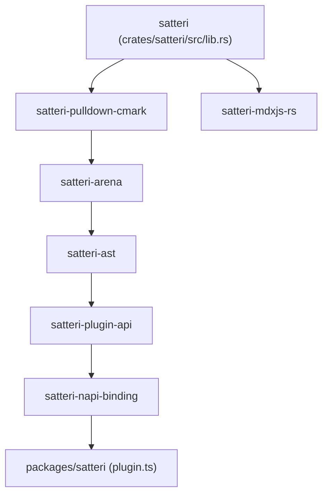

# bruits/satteri

> Fast Markdown and MDX processing: parser and compiler in Rust, plugins in JavaScript.

## The problem
The remark and rehype chains are slow on large document corpora, and rewriting the plugins in Rust is expensive.

## What it actually does
The parser (a fork of pulldown-cmark) and the MDX compilation (a fork of mdxjs-rs adapted to OXC) run in Rust. Trees are stored in a compact arena. An N-API binding, with a WASI entry for the browser, exposes these trees to JavaScript plugins that return edit commands. There is also a Vite plugin and an Expressive Code plugin.

## How it is wired


## Trying it
```bash
# Aucune commande dans le README : voir la documentation et le playground en ligne.
```

## Cost and gotchas
Free. Requires Node for the JavaScript part (not detailed in the README). Young project (created in March 2026).

## What it is not
Not a site generator. No quantified evaluation in the README: no performance measurement appears there.

## Alternatives
The README cites the projects it is a fork of: mdxjs-rs and pulldown-cmark.

## For you
Worth watching: useful only if you process large volumes of Markdown or MDX, for example to prepare document corpora.
