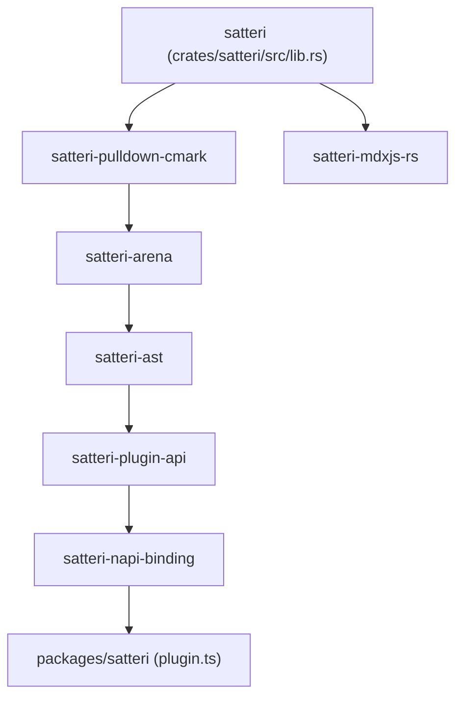

# bruits/satteri

> Traitement Markdown et MDX rapide : parseur et compilateur en Rust, plugins en JavaScript.

## Le problème
Les chaînes remark et rehype sont lentes sur de gros corpus de documents, et réécrire les plugins en Rust coûte cher.

## Ce que ça fait vraiment
Le parseur (fork de pulldown-cmark) et la compilation MDX (fork de mdxjs-rs adapté à OXC) tournent en Rust. Les arbres sont stockés dans un arena compact. Une liaison N-API, avec entrée WASI pour le navigateur, expose ces arbres à des plugins JavaScript qui renvoient des commandes d'édition. Il y a aussi un plugin Vite et un plugin Expressive Code.

## Comment c'est branché


## Essayer
```bash
# Aucune commande dans le README : voir la documentation et le playground en ligne.
```

## Coût et pièges
Gratuit. Nécessite Node pour la partie JavaScript (non détaillé dans le README). Projet jeune (créé en mars 2026).

## Ce que ce n'est pas
Pas un générateur de site. Pas une évaluation chiffrée dans le README : aucune mesure de performance n'y figure.

## Alternatives
Le README cite les projets dont il est un fork : mdxjs-rs et pulldown-cmark.

## Pour toi
À surveiller : utile seulement si tu traites de grands volumes de Markdown ou MDX, par exemple pour préparer des corpus de documents.

