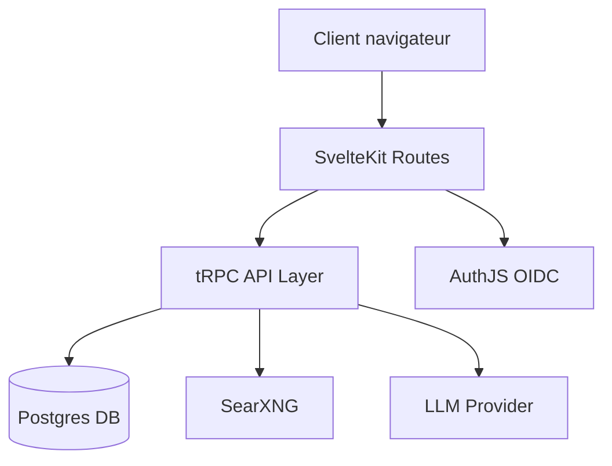

# brunostjohn/perplexideez

> Self-hosted, multi-user Perplexity clone, plugged into Postgres, SearXNG and Ollama or OpenAI.

## The problem
Existing Perplexity clones integrate poorly with other self-hosted services and ignore multi-user.

## What it actually does
- Single SvelteKit application with a tRPC API, Prisma persistence on Postgres.
- Searches the web through a SearXNG instance, then has the answer written by Ollama or an OpenAI-compatible endpoint.
- Multi-user login through AuthJS and optional OIDC, Prometheus metrics.
- Deployment via Docker Compose or a Kubernetes Helm chart.

## How it is wired

## Trying it
No command documented in the README provided; the architecture mentions `deploy/docker/compose.yml` and a Helm chart, without a command.

## Cost and gotchas
You need Postgres, a SearXNG instance and an LLM (local Ollama or an OpenAI API key). Last push in November 2024: barely active project, 16 open issues.

## What it is not
Not a search engine: it depends on SearXNG. Not a maintained product: a single maintainer, no recent activity. The AGPL license requires publishing modifications served over a network.

## Alternatives
No alternative named in the README.

## For you
Ignore: with no commit in a year, maintenance is no longer assured, and the Postgres plus SearXNG plus LLM stack is costly to set up for a frozen tool.
