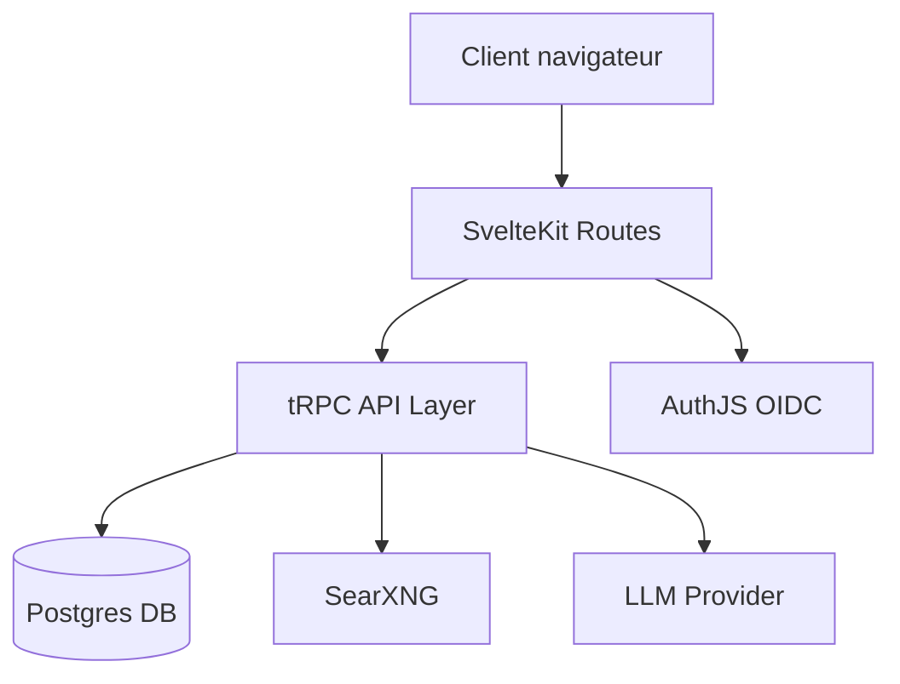

# brunostjohn/perplexideez

> Clone auto-hébergé de Perplexity, multi-utilisateur, branché sur Postgres, SearXNG et Ollama ou OpenAI.

## Le problème
Les clones de Perplexity existants s'intègrent mal aux autres services auto-hébergés et ignorent le multi-utilisateur.

## Ce que ça fait vraiment
- Application SvelteKit unique avec API tRPC, persistance Prisma sur Postgres.
- Cherche sur le web via une instance SearXNG, puis fait rédiger la réponse par Ollama ou un endpoint compatible OpenAI.
- Connexion multi-utilisateur via AuthJS et OIDC optionnel, métriques Prometheus.
- Déploiement par Docker Compose ou chart Helm Kubernetes.

## Comment c'est branché

## Essayer
Aucune commande documentée dans le README fourni ; l'architecture évoque `deploy/docker/compose.yml` et un chart Helm, sans commande.

## Coût et pièges
Il faut Postgres, une instance SearXNG et un LLM (Ollama local ou clé d'API OpenAI). Dernier push en novembre 2024 : projet peu actif, 16 issues ouvertes.

## Ce que ce n'est pas
Pas un moteur de recherche : il dépend de SearXNG. Pas un produit suivi : un seul mainteneur, aucune activité récente. La licence AGPL impose de publier les modifications servies en réseau.

## Alternatives
Aucune alternative nommée dans le README.

## Pour toi
À ignorer : sans commit depuis un an, la maintenance n'est plus assurée, et la pile Postgres plus SearXNG plus LLM coûte cher à monter pour un outil figé.

